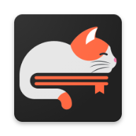
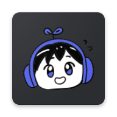

# Kurobayomi extensions

Anime and manga sources for [Kurobayomi](https://github.com/anas1412/kurobayomi), the anime and manga app for the Linux
desktop.

Kurobayomi ships with no sources. You add a repository like this one by its link, and its sources appear in the app
straight away. There is nothing to install.

## Add this repository

1. In Kurobayomi, click **Add a source repository** on the welcome screen, or go to **Browse → menu → Repositories → Add**.
2. Paste this link and click **Add**:

   ```
   https://raw.githubusercontent.com/anas1412/kurobayomi-extensions/main/index.min.json
   ```

3. The sources show up in **Browse**, grouped by language.

The app checks the repository once a day and picks up fixes and new sources by itself. To remove it, delete its link
under **Repositories**; its sources go with it. The app's [Getting started](https://github.com/anas1412/kurobayomi/blob/main/docs/GETTING-STARTED.md)
guide walks through this with screenshots.

## Sources

Each source row in the app has a coloured dot: green works, orange means the site is blocking the app for now, red
means the source is broken and needs a fix.

| | Source | Kind | Language | What works |
|---|---|---|---|---|
|  | MangaDex | manga | en | popular, latest, search, every English chapter |
|  | MangaPill | manga | en | trending, latest, search, chapters (no dates) |
|  | Mangakakalot | manga | en | hot, latest, search, chapters with dates |
|  | Weeb Central | manga | en | popular, latest, search with filters, chapters |
|  | KickAssAnime | anime | en | streaming with subtitles and audio tracks |
|  | AnimePahe | anime | en | airing list, search, streaming in 360p to 1080p |
|  | BeatZ Anime | anime | es | 🔴 browsing only: search and playback need app support ([NEEDS-ENGINE.md](NEEDS-ENGINE.md)) |

Mangakakalot and AnimePahe sit behind Cloudflare's browser check, so they need a recent Kurobayomi that can pass it.

Each source's folder under [`sources/`](sources) has a README with the details: what it does, what was left out, and
the extension it was ported from.

## Something broken?

Open an issue with the source's name, what you did, and what happened. A screenshot of the error helps. If a site
changed and you can fix it yourself, see [CONTRIBUTING.md](CONTRIBUTING.md).

## Licence

Apache License 2.0. Every source is a port of an open-source Aniyomi, Mihon or keiyoushi extension, and the site icons
are those extensions' launcher icons. See [LICENSE](LICENSE) and [NOTICE](NOTICE).
